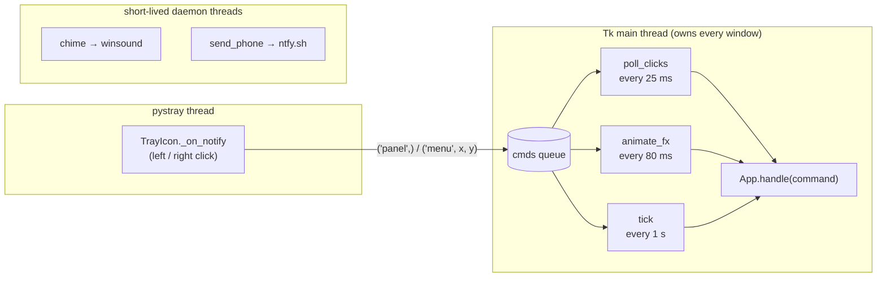
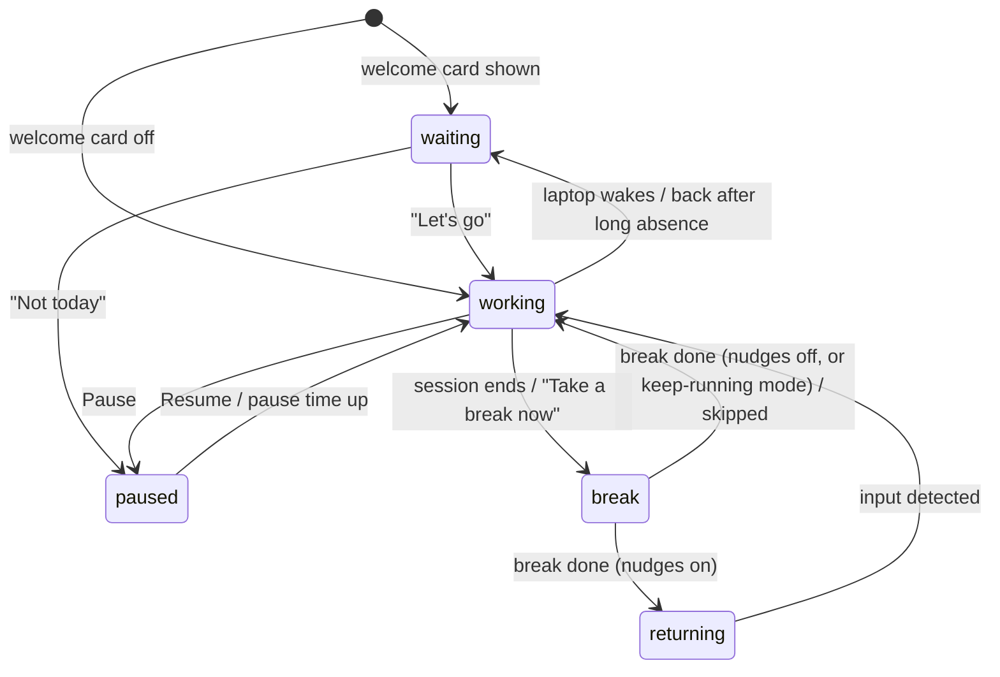

# Flow: application architecture

This document describes how Flow is built: what it is for, how the code is organised, how the pieces talk to
each other, where data lives, how it is built and tested, the main design decisions, and a record of every
change since the first commit.

For the story behind the app in plain language, see [BUILD_STORY.md](BUILD_STORY.md). For features and
screenshots, see the [README](../README.md).

## Contents

1. [Purpose and scope](#1-purpose-and-scope)
2. [Constraints](#2-constraints)
3. [Technology stack](#3-technology-stack)
4. [Repository layout](#4-repository-layout)
5. [Runtime architecture](#5-runtime-architecture)
6. [The state machine](#6-the-state-machine)
7. [The three clocks](#7-the-three-clocks)
8. [User interface components](#8-user-interface-components)
9. [Theming, motion and rendering](#9-theming-motion-and-rendering)
10. [Windows integration](#10-windows-integration)
11. [Data and persistence](#11-data-and-persistence)
12. [Build and distribution](#12-build-and-distribution)
13. [Testing](#13-testing)
14. [Design decisions](#14-design-decisions)
15. [Known limitations](#15-known-limitations)
16. [Change history](#16-change-history)

---

## 1. Purpose and scope

Flow is a Windows system-tray app that makes you take breaks and get out of your chair.

It does three jobs:

| Job | How |
|---|---|
| **Focus sessions** | A work timer (default 50 min) followed by a screen break (default 10 min). |
| **Breaks you can't sit through** | The break screen covers every monitor, and its countdown only runs while there is no keyboard or mouse input. The only way through is to get up. |
| **Stand-ups** | A separate sitting clock (default every 30 min) brings up a small card asking you to stand for a couple of minutes. The session keeps running. |

Around those it adds a heads-up before each break, back-to-work nudges (optionally to a phone through ntfy),
a welcome card on start or wake, pause and meeting mode, weekly stats, and themes and animations.

Out of scope: macOS and Linux, accounts or syncing, and any server of its own.

## 2. Constraints

- **Windows 10/11 only.** Idle detection, window styling, the registry, the single-instance mutex and sound
  all use Windows APIs directly.
- **One person, one PC.** All state is local JSON. No network except the optional ntfy push.
- **Always running, so it must be cheap.** It sits in the tray all day, so CPU use (mostly from the animated
  tray icon) is something to watch.
- **It must not guess wrong about whether you're there.** The author often studies on an iPad, so "no input"
  does not always mean "away". This shaped the idle handling (see [§14](#14-design-decisions)).
- **Must ship as one file** that runs on PCs without Python.

## 3. Technology stack

| Layer | Choice | Notes |
|---|---|---|
| Language | Python 3.10+ | One source file, `flow.pyw` (about 3,800 lines). `.pyw` so no console window opens. |
| UI toolkit | Tkinter (standard library) | Every visible widget is custom: drawn with Pillow onto a `tk.Canvas` or `tk.Label`. |
| Drawing | Pillow ≥ 10 | Rings, pills, toggles, bars, gradients, glows. Drawn at 4× size and scaled down for smooth edges. |
| Tray icon | pystray ≥ 0.19 | Subclassed (`TrayIcon`) to take over clicks and to build icons in memory. |
| OS access | `ctypes`, `winreg`, `winsound` | `user32`, `kernel32`, `dwmapi`, `shcore`, `shell32`. |
| Phone push | ntfy.sh over `urllib` | Optional and off by default. |
| Packaging | PyInstaller | One-file, no-console `Flow.exe`. |
| Tests | Plain Python scripts | No test framework. They drive the real app inside Tk's event loop. |

The only third-party runtime dependencies are `pystray` and `Pillow` ([requirements.txt](../requirements.txt)).

## 4. Repository layout

```
flow/
├── flow.pyw              The whole app
├── flow.ico              App icon, generated by tools/make_icon.py
├── requirements.txt      pystray, Pillow
├── build.ps1             Builds dist\Flow.exe (and optionally installs it)
├── tools/
│   └── make_icon.py      Draws flow.ico from the in-app logo code
├── tests/
│   ├── _harness.py       Loads flow.pyw with throwaway settings and fakes idle time
│   ├── run_all.py        Runs every suite and prints one summary
│   ├── test_behaviour.py Sessions, breaks, stand-ups, settings, themes, migration
│   ├── test_timer.py     Timer accuracy against the real clock
│   └── test_windows.py   Window placement, title bars, closing, per animation mode
├── docs/
│   ├── ARCHITECTURE.md   This document
│   ├── BUILD_STORY.md    The story of how Flow was built
│   └── *.png             Screenshots used by the README
├── README.md
└── LICENSE               MIT
```

Ignored by git: `build/`, `dist/`, `*.spec`, `__pycache__/`, and any stray `config.json` / `stats.json`.

### Inside `flow.pyw`

The file reads top to bottom in layers, from lowest to highest level:

| Section | What's in it |
|---|---|
| Timer patch | Replaces `tk.Misc.after` / `after_cancel` so every timer is scheduled on the root window (see [§14](#14-design-decisions)). |
| Paths and `DEFAULTS` | Data folder paths, the default settings, and the legacy-folder migration. |
| Content | Welcome lines, nudge wording, stand-up moves, break tips, presets, choice lists. |
| Palette and themes | Fixed neutrals (`BG`, `SURFACE`, …), the six `THEMES`, `EFFECTS`, `SPEEDS`. |
| Colour helpers | `hex_rgb`, `mix`, `sample`, `contrast`, `luminance`, `theme_stops`. |
| `Theme`, `Motion`, `apply_theme` | The palette and each animated element's motion (see [§9](#9-theming-motion-and-rendering)). |
| `EdgeGlow` | The animated border drawn around windows. |
| Scaling and fonts | `UI_SCALE`, `px()`, `font()`, `pick_fonts()`. |
| Win32 helpers | `idle_seconds`, screens and work area, single-instance mutex, `style_window`, `cover_window`, `hidden_toplevel`, `animate_in`, `tray_corner`. |
| Startup and tray pin | Registry Run key, `pin_tray_icon`, `migrate_startup`. |
| Sound and phone | `chime`, `send_phone`. |
| Config and stats | `load_config` (with migration), `save_config`, `load_stats`. |
| Image primitives | `rounded`, `gradient_arc`, `ring_mark`, `badge_image`, `app_logo`, `bar_image`. |
| Widgets | `PillButton`, `Card`, `Toggle`, `Stepper`, `Slider`, `NavList`, `Tabs`, form helpers. |
| Windows | `BreakOverlay`, `Toast`, `WelcomeWindow`, `StandPrompt`, `TrayIcon`, `TrayMenu`, `SessionPanel`, `ColorPicker`, `SettingsWindow`, `AdvancedWindow`, `BarChart`, `StatsWindow`. |
| `App` | State, the loops, command handling, all timer logic, the tray frame. |
| Entry point | Single-instance check, data migration, app identity, DPI awareness, `App().run()`. |

## 5. Runtime architecture

### Startup

`__main__` does, in order:

1. `already_running()`: creates a named mutex and exits quietly if another Flow already holds it.
2. `migrate_data()`: creates `%APPDATA%\Flow` and copies settings and stats from the old `~/standup-app`
   folder if they aren't there yet.
3. Sets an explicit AppUserModelID (`Flow.FocusBreaks`) so the taskbar shows Flow's icon instead of Python's.
4. Turns on per-monitor DPI awareness.
5. Builds `App` (with `--demo` for 1-minute sessions) and enters Tk's main loop.

`App.__init__` hides the root window, measures `UI_SCALE`, picks fonts, loads config and stats, applies the
theme, starts the tray icon on its own thread, migrates the old startup entry, schedules the tray pin (at 4 s
and 30 s, since Windows registers icons late) and the welcome card, then starts the loops below.

### Threads



- **Tk main thread.** Owns every window and all app state. Nothing else touches Tk.
- **pystray thread.** Runs the tray icon's message loop. Clicks are turned into commands and put on
  `App.cmds` (a `queue.Queue`). The thread never touches a window itself.
- **Worker threads.** Fire-and-forget daemon threads for playing the chime and posting to ntfy, so neither
  blocks the UI.

### The three loops

All three run on the Tk thread using `after()`, and all three drain the command queue, so a tray click is
handled within about 25 ms whatever else is going on.

| Loop | Period | Job |
|---|---|---|
| `poll_clicks` | 25 ms | Handles tray clicks quickly so the panel opens and hides instantly. |
| `animate_fx` | 80 ms (~12 fps) | Renders the stand-up card's border, the panel's border and live countdown, the break-screen frame, and the tray icon. |
| `tick` | 1 s | All timer logic: idle detection, sleep detection, the state machine, the sitting clock, nudges, config reload, tray tooltip. |

### Commands

Every user action arrives as a command name for `App.handle()`, whether it came from the tray thread or a
button: `panel`, `menu`, `pause`, `resume`, `snooze`, `break_now`, `skip_next`, `stand_now`, `reset`, `preset`,
`set`, `settings`, `stats`, `quit`. Having one entry point keeps the rules (for example "you can't pause during a
break") in one place.

## 6. The state machine

`App.state` is one of five values:



| State | Meaning | What `tick` does |
|---|---|---|
| `working` | A focus session is running. | Adds elapsed time to `work_elapsed`, watches for quiet spells and sleep, checks the heads-up and break. |
| `break` | The break screen is up. | Counts `break_remaining` down only while idle ≥ `away_threshold_seconds` (or always, in keep-running mode). Input pauses it, or restarts it in strict mode. |
| `returning` | The break is over, waiting for you to come back. | First input since the break ended → `welcome_back()`. Otherwise sends firmer nudges on a timer, up to `return_max_nudges`. |
| `paused` | The session is frozen. | Resumes by itself when `pause_until` passes (if set). |
| `waiting` | The welcome card is open, or "give me 5 min" was chosen. | Shows the welcome card again when `welcome_again_at` passes. |

Two flags sit alongside the state rather than inside it:

- **`snooze_until`**: meeting mode and "5 more min". Holds back both the break and stand-ups until then.
- **`skip_next`**: "Skip next break". When the session ends, it is logged as skipped and the next session starts.

**Stand-ups only** mode (`timer_mode`) reuses the same machine with sessions and breaks turned off. The tray
ring then counts down to the next stand-up.

## 7. The three clocks

Flow keeps three separate amounts of time. All of them add up real time measured with `time.monotonic()`
(`gap` = time since the last tick) instead of counting ticks, so a late tick never makes a timer drift.

| Clock | Field | Runs when | Resets when |
|---|---|---|---|
| Session | `work_elapsed` | `working` | Session ends, break ends, "It was a break", laptop sleep (activity mode), very long sleep (keep-running mode), Restart. |
| Sitting | `sit_elapsed` | `working`, and not while the stand-up card is in its *moving* or *done* phase | Stand-up done, break starts, "It was a break", laptop sleep. |
| Break | `break_remaining` | `break` and away (or always in keep-running mode) | Counts down from `break_minutes`. Restarts on input in strict mode. |

### Idle and sleep handling

This is the part that went wrong most often, so the rules are spelled out:

- **Idle** = seconds since the last keyboard or mouse input anywhere in Windows (`GetLastInputInfo`).
- **Sleep** shows up as a large `gap` between ticks (monotonic time jumps when the PC wakes).
- **Activity mode** (`use_activity` on, the default):
  - A gap ≥ `idle_reset_minutes` while working means the laptop slept, which counts as a break. Both the session and sitting clocks reset.
  - Idle ≥ `idle_reset_minutes` without sleep is a *quiet spell*. The session keeps counting. When input comes
    back, Flow asks *"Away N min. Was that a break?"* and only resets if you say yes.
- **Keep-running mode** (`use_activity` off, for working on another device):
  - The session always counts, sleep included. Breaks count down by the clock, and the next session starts
    straight after a break.
  - A gap longer than two sessions (and at least an hour), such as overnight, starts fresh, so you don't open
    the laptop to an instant break screen.
- **Welcome card triggers**: the wall clock jumped more than 5 minutes (woke from sleep), or you came back after
  `welcome_after_idle_minutes` of idle.

### Stand-up rules (`check_stand_due`)

A stand-up card appears when all of these are true: reminders are on, you're working, nothing is snoozed,
`sit_elapsed` ≥ `stand_every_minutes`, and a screen break isn't less than 5 minutes away (it would get you up
anyway). If the card is ignored and `stand_renudge` is on, it comes back firmer every
`stand_renudge_minutes`, with a chime and phone push for the first five times.

## 8. User interface components

Every window is a `tk.Toplevel` styled by Flow itself. None use native Tk widgets for their look.

| Component | Opens from | Purpose |
|---|---|---|
| `SessionPanel` | Left-click on the tray icon | Time left, pause/resume and quick actions, with a live countdown. Sits by the tray, has an animated border, closes when it loses focus and hides itself after 20 s (the countdown waits while the mouse is over it). |
| `TrayMenu` | Right-click on the tray icon | Flow's own menu (not the native one): pause chips, stand up now, take a break, skip next break, meeting mode, restart, focus and break length chips, settings, stats, quit. |
| `BreakOverlay` | Break starts | One borderless window covering the whole virtual screen, with a glowing frame, a large countdown, a slim progress bar, a tip and a status line. Skip is one click or a typed phrase. |
| `StandPrompt` | Sitting clock due | A small card with three phases: *ask* (with a suggested move), *moving* (an on-your-feet countdown) and *done*. Gets firmer when ignored. |
| `Toast` | Many places | A notification by the tray with optional buttons and an auto-dismiss countdown. Only one is open at a time (`App.toast`). |
| `WelcomeWindow` | Start, wake, long absence | Greeting, how yesterday went, "your one focus" box, and Let's go / Give me 5 min / Not today. |
| `SettingsWindow` | Menu → Settings | Sidebar with six pages (Schedule, Stand up, Break, Back to work, Appearance, General), a Save button, and Advanced. |
| `AdvancedWindow` | Settings → Advanced | Detecting you (away threshold, natural-break length, keep-running mode), reminders (nudge count, welcome-back delay), and reset to defaults. |
| `ColorPicker` | Appearance page | A colour wheel, brightness, and hex/RGB entry for custom gradient stops. |
| `StatsWindow` + `BarChart` | Menu → Your stats | Weekly breaks taken and skipped, longest sit, on-time returns, with hover tooltips. |

### Shared window behaviour

- **No flash on open.** `hidden_toplevel()` creates each window invisible and off-screen. `animate_in()` moves it
  into place first and only then fades (and optionally slides) it in.
- **Placement.** `tray_corner()` puts popups next to the tray and works whether the taskbar is at the bottom or
  the top. `center_on_primary()` is used for Settings and Stats. Everything stays on the main monitor.
- **Dark chrome.** `style_window()` sets the dark title bar, rounded corners and border colour through DWM.
- **Click toggling.** Clicking the tray icon again hides an open panel or menu. A focus loss closes the popup
  first, so `just_auto_closed()` remembers that for 0.6 s and treats the click as "hide" rather than reopening it.
  A second click within 0.4 s (a double-click) is ignored.
- **Single instance per window.** `_open_single()` raises an existing Settings or Stats window instead of
  opening a second one.

### Widgets

`PillButton`, `Toggle`, `Stepper`, `Slider`, `Card`, `NavList` and `Tabs` are small `Canvas`/`Frame`
subclasses. Each draws its look with Pillow (`rounded()`, at 4× size and then scaled down) and reads the theme
colours when it is built, so rebuilding a window picks up a new theme.

## 9. Theming, motion and rendering

### Colours

- **Neutrals are fixed**: `BG #0a0a0a`, `SURFACE #141414`, `SURFACE_2 #1e1e1e`, `BORDER #2a2a2a`, plus
  text greys, `WARN` (amber) and `IDLE` (grey). These were changed from blue-grey to true black in `a5274d7`.
- **A theme is a list of 2–6 colours** (`THEMES`: Sunset, Ocean, Violet, Rose, Ember, Mono, plus Custom, which
  builds three stops around one accent). Users can replace any theme's stops. Those are saved in
  `theme_stops[name]`.
- `apply_theme(cfg)` recalculates the module-level globals: `THEME`, `ACCENT`, a hover shade, an ink colour for
  text on the accent (whichever of black or white has more contrast), and a chart colour lightened until it has
  3:1 contrast on the card.

### Motion

Colour and movement are separate. Each animated element gets its own `Motion(effect, speed)`:

| Element | Global | Effects |
|---|---|---|
| Tray icon | `TRAY_FX` | Static, Breathe, Flow, Rainbow (never Off, because the icon must always show) |
| Panel border | `PANEL_FX` | Off, Static, Breathe, Flow, Rainbow |
| Break screen | `BREAK_FX` | Off, Static, Breathe, Flow, Rainbow |

Speeds are seconds per cycle: Slow 30, Medium 12, Fast 5. `Motion` gives `color()` (one colour now),
`ring_colors()` (colours around a ring) and `loop_colors()` (for a border that circulates).

### Rendering

- **Rings** (`ring_mark`, `gradient_arc`): a gradient arc with round caps and an optional glow. Drawn clockwise
  and mirrored by `orient()` when the ring direction is counter-clockwise.
- **Animated borders** (`EdgeGlow`): eight `Label`s per window (four sides and four corner pieces). A looping
  gradient strip (cached in `_LINES`) is sliced into sides. Corners are curved to match the ~8 px corners
  Windows 11 gives windows, so there are no gaps or notches.
- **Tray icon**: `tray_frame()` turns the current state into a small key (colours, steps left out of 120,
  centre glyph, effect step). The icon is only redrawn when that key changes, and at most ~7 times a second.
  `TrayIcon._assert_icon_handle()` builds the Windows icon straight from PNG bytes with
  `CreateIconFromResourceEx` instead of pystray's temp-file round trip.
- **Logo**: `app_logo(size)` draws the app logo. The window icons, the Settings badge and `flow.ico` all come
  from it.

### Applying a new theme without flicker

Saving appearance settings rebuilds open windows in place. For the Settings window, `rebuild()` takes a
screenshot of the window (`cover_window`), lays it on top, rebuilds everything underneath, then removes the
picture 40 ms later (`uncover`). You never see a half-drawn frame. The session panel and stats window are just
rebuilt.

## 10. Windows integration

| Need | API |
|---|---|
| Time since last input | `user32.GetLastInputInfo` and `kernel32.GetTickCount` (wraps at 32 bits, masked) |
| Monitors and taskbar | `GetSystemMetrics` (virtual and primary screen), `SystemParametersInfoW(SPI_GETWORKAREA)` |
| One instance only | `CreateMutexW("StandUpApp_SingleInstance")` + `ERROR_ALREADY_EXISTS` |
| Dark title bar, rounded corners, border colour | `DwmSetWindowAttribute` attributes 20, 33, 34 |
| Taskbar identity | `SetCurrentProcessExplicitAppUserModelID("Flow.FocusBreaks")` |
| Sharp on high-DPI screens | `SetProcessDpiAwareness(2)`, and every size goes through `px()` |
| Start with Windows | `HKCU\Software\Microsoft\Windows\CurrentVersion\Run\Flow` (old `Rise` / `StandUp` entries are moved over) |
| Always show the tray icon | Sets `IsPromoted=1` under `HKCU\Control Panel\NotifyIconSettings` for Flow's exe |
| Tray clicks | `WM_LBUTTONUP` / `WM_RBUTTONUP` in `TrayIcon._on_notify`, plus `SetForegroundWindow` so popups get keyboard focus |
| Tray icon from memory | `CreateIconFromResourceEx` |
| Sound | A three-note chime (C5–E5–G5) synthesised as a WAV in memory and played with `winsound.SND_MEMORY`, so it follows the system volume |

## 11. Data and persistence

All data lives in `%APPDATA%\Flow` (falling back to the home folder), so the exe can live anywhere.

### `config.json`

The full settings dictionary, with defaults from `DEFAULTS`. Main groups:

| Group | Keys |
|---|---|
| Schedule | `timer_mode`, `work_minutes`, `break_minutes`, `warn_minutes_before`, `breaks_enabled` |
| Stand-ups | `stand_reminders`, `stand_every_minutes`, `stand_for_minutes`, `stand_renudge`, `stand_renudge_minutes` |
| Presence | `use_activity`, `idle_reset_minutes`, `away_threshold_seconds` |
| Break screen | `reset_break_on_input`, `skip_style`, `skip_phrase` |
| Back to work | `return_nudges`, `return_grace_minutes`, `return_nudge_every_minutes`, `return_max_nudges`, `goal` |
| Phone | `phone_notify`, `ntfy_topic` |
| General | `chime_volume`, `welcome_popup`, `welcome_after_idle_minutes` |
| Appearance | `theme`, `accent`, `theme_stops`, `tray_/panel_/break_effect`, `tray_/panel_/break_speed`, `ring_direction`, `window_anim` |

Rules:

- `load_config()` starts from `DEFAULTS` and lays the saved file on top, so new settings get their defaults in
  older files. It reads with `utf-8-sig` so a file saved by Notepad (with a BOM) still loads.
- **Migration**: the old single `effect` / `effect_speed` / `border_style` / `fx_*` keys are converted into the
  per-element `*_effect` / `*_speed` keys, then removed.
- On first run it generates an `ntfy_topic` like `flow-a1b2c3d4e5`, because anyone who knows the topic name can
  read the notifications.
- `tick` checks the file's modification time every second and reloads it if it changed, so hand edits apply
  live. A half-written or invalid file is ignored and the last good settings are kept.
- Settings saved from the UI go through `App.apply_settings()`, which saves, re-themes, and refreshes open windows.

### `stats.json`

A dictionary keyed by ISO date, one dictionary of counters per day:

```json
{
  "2026-10-13": {
    "sessions_done": 2, "breaks_taken": 3, "breaks_skipped": 1, "snoozes": 1,
    "on_time_returns": 2, "late_returns": 1, "minutes_over": 4,
    "stand_ups": 5, "stand_snoozes": 1, "longest_sitting_minutes": 47
  }
}
```

`App.bump(key, value, mode)` adds to a counter (or keeps the maximum, for `longest_sitting_minutes`) and
rewrites the file straight away.

## 12. Build and distribution

```powershell
.\build.ps1            # build dist\Flow.exe
.\build.ps1 -Install   # also install to %LOCALAPPDATA%\Programs\Flow, add a Start menu shortcut, and start it
```

[build.ps1](../build.ps1) does:

1. `pip install -r requirements.txt pyinstaller`
2. `py tools\make_icon.py`: regenerates `flow.ico` from `app_logo()` at 256, 128, 64, 48, 32, 24 and 16 px, each
   drawn separately so the small sizes stay crisp. **This is why `flow.ico` changes after every build**, even when
   the logo code hasn't changed.
3. PyInstaller with `--onefile --noconsole --icon flow.ico`, giving a single ~19 MB `dist\Flow.exe`.
4. With `-Install`: stops the running copy (the exe is locked while it runs), copies the exe, creates the Start
   menu shortcut and launches it.

Each step checks `$LASTEXITCODE` rather than using `-ErrorAction Stop`, because Windows PowerShell 5.1 treats
any text on stderr (like pip's upgrade notice) as an error.

When running as the exe (`FROZEN`), the startup entry points to the exe itself. When running from source, it
points to `pythonw.exe flow.pyw`.

## 13. Testing

```powershell
py tests\run_all.py
```

| Suite | Covers |
|---|---|
| `test_behaviour.py` | The session → heads-up → break → returning → working cycle; skip by phrase and by one click; tray click toggling; stand-up asking, re-asking and stand-ups-only mode; pause, resume and meeting mode; quiet spells and sleep; keep-running mode; tray icon states; every animation effect; saving every Settings page; the colour picker; Advanced; themes following into open windows; migrating older settings. |
| `test_timer.py` | Over 15 s, counted time matches the real clock within 1.2 s, and the panel countdown drops by exactly one second each second. |
| `test_windows.py` | For each window animation mode (Slide, Fade, None) and each window: it lands fully on screen and inside the main monitor, has a dark title bar, and closes with its X. |

How the harness works ([tests/_harness.py](../tests/_harness.py)):

- Loads `flow.pyw` as a module and points `CONFIG_PATH` / `STATS_PATH` at a fresh temp folder.
- Replaces everything with side effects: registry startup, tray pinning, the chime, and `send_phone` (which
  records calls in `m.sent` instead).
- Fakes idle time through `m.FAKE_IDLE`, so "away for seven minutes" takes no time to test.
- `tick(app, n, gap)` moves the 1-second timer forward by any amount of time.
- `run_steps` runs test steps one after another inside Tk's real event loop, so windows really open.
- A watchdog kills a stuck suite (`os._exit(2)`) so no windows are left on screen. Uncaught Tk callback errors
  count as failures.

## 14. Design decisions

Each entry is a decision that shapes the code, why it was made, and what it costs.

**D1. The break counts down only while you're away.**
Why: a break that just ends after N minutes can be waited out in the chair. Cost: needs reliable idle detection,
and doesn't work for people who aren't at the PC (hence D4).

**D2. Ask, don't guess, after a quiet spell.**
Earlier versions treated 5 minutes without input as a break and silently restarted the session, which was wrong
when reading, watching a lecture, or using an iPad. Now the session keeps counting and Flow asks *"Was that a
break?"*. Laptop sleep is still treated as a definite break.

**D3. No input does not mean you stood up.**
The sitting clock used to reset after `stand_for_minutes` of idle. Fixed in `0b0016d`: only a stand-up, a
break, "It was a break" or sleep resets it.

**D4. Keep-running mode.**
For working away from the PC: ignore input completely and run every timer by the clock. Very long sleeps start
fresh so you don't wake the laptop into a break.

**D5. Real elapsed time, not tick counts.**
Every clock adds `time.monotonic()` deltas, so timers stay accurate even when the UI is busy.

**D6. Only the Tk thread touches windows.**
The tray thread only puts commands on a queue. This avoids Tk's thread-safety problems at the cost of up to
25 ms latency on a click.

**D7. All `after()` timers live on the root window.**
Tk deletes a window's callbacks when it closes, and a timer still queued could then fire into a newer callback
that reused the same internal name, calling the wrong function. Patching `tk.Misc.after` / `after_cancel` to
always use the root (which lives as long as the app) prevents that. Callbacks still check `winfo_exists()`
before touching their window.

**D8. Windows start hidden and off-screen.**
Prevents a flash at Windows' default top-left position. `animate_in()` always sets the final position before
showing the window. This fixed windows that were "open" but stuck off-screen.

**D9. Custom-drawn UI over native widgets.**
Tkinter's native look didn't fit a calm dark app. Everything is drawn with Pillow at 4× and scaled down. Cost:
more code (about a third of the file is drawing and widgets).

**D10. Colour and motion are separate.**
One shared "effect" setting felt cluttered. A theme is now just colours, and each element has its own effect
and speed. Old settings are migrated automatically.

**D11. Screenshot cover for in-place rebuilds.**
Pausing Windows' drawing during a rebuild sometimes left the window black. Laying a screenshot over the window
while it rebuilds is simple and reliable.

**D12. Tray icon in memory, redraws capped.**
pystray writes every frame to a temp `.ico`. Building icons in memory with `CreateIconFromResourceEx`, drawing
at lower resolution, and only redrawing when the frame key changes cut tray animation from ~8.5% to ~2.6% of a
CPU core (`dfc11d8`).

**D13. One source file.**
Easy to run (`pyw flow.pyw`), easy to package, and the tests and icon tool load it as a module. Cost: a long
file. The layered order in [§4](#inside-flowpyw) keeps it navigable.

**D14. Local JSON, no backend.**
Settings and stats are small, private and per-PC. The only network call is the optional ntfy push.

## 15. Known limitations

- Windows only. Several features rely on Windows 11 (rounded corners, border colour); on Windows 10 they
  quietly fall back to plain windows.
- Anyone who learns your ntfy topic name can read your notifications. The random topic makes it hard to guess
  but it isn't private.
- The single-instance mutex still uses the old name `StandUpApp_SingleInstance`. It works, but changing it would
  allow an old and a new copy to run together.
- `stats.json` is rewritten on every counter change. That's fine at this size but would not scale.
- Idle detection can't tell a passive activity (reading at the desk) from being away. D2 handles this by asking.
- Popups always open on the main monitor.

## 16. Change history

Every commit since the repository was created, oldest first. Work done before the first commit (the *Stand Up*
and *Rise* versions) is described in [BUILD_STORY.md](BUILD_STORY.md).

### 1 October 2026

| Commit | Change |
|---|---|
| `36f3d80` | **First working version of Flow.** `flow.pyw` (3,211 lines), README, LICENSE, requirements, icon and screenshots. Sessions, the away-only break screen, nudges, welcome card, stats, themes and animations were already in place. |
| `bbb6c6f` | Linked the web demo in the README. |

### 2 October 2026

| Commit | Change |
|---|---|
| `dfc11d8` | **Tray CPU fix.** Icons built in memory instead of through temp files, frames drawn smaller, and redraws only on visible change. About 3× cheaper. |
| `67b280d` | **Tests and build script.** Added the test harness and three suites, `run_all.py`, `build.ps1` and `tools/make_icon.py`. |
| `1a89b35` | Logo changed from a partial arc (it looked like a loading spinner) to a full ring. Icon regenerated. |
| `900749d` | New Sunset colours (golden hour to violet twilight). Gradients editable, 2–6 stops per theme (`theme_stops`). |
| `86dd9de` | **Stand-up reminders.** The sitting clock, `StandPrompt`, the stand-up settings page, the moves list, firmer re-asks and stand-up stats. |
| `d2b4772` | Session panel hides itself after 20 s (waiting while the mouse is over it). |
| `cfe485c` | Tidied up the screenshots. |
| `0b0016d` | **Sitting clock fix.** Idle and sleep no longer counted as sitting, `reset_sitting()` added, long sleeps in keep-running mode start fresh, and the root-window `after()` patch (D7) added. |
| `267e22d` | Sharper screenshots. |

### 3 October 2026

| Commit | Change |
|---|---|
| `6b63fad` | Added [BUILD_STORY.md](BUILD_STORY.md), linked from the README. |
| `a1ec016` | Reworded the build story intro. |
| `5ecdc6b` | **Skipping and turning off breaks.** `breaks_enabled`, `skip_style` (one click or typed phrase), and "Skip next break" in the tray menu. |

### 7 October 2026

| Commit | Change |
|---|---|
| `7bf24ba` | Updated the demo link. |
| `b843160` | Removed the demo link for now. |
| `92fef3b` | **Stand-ups only mode** (`timer_mode`). No sessions or breaks; the tray ring counts down to the next stand-up. |
| `a38a679` | Panel border preview flicker and late corners fixed: cached gradient strips (`_LINES`) and borders rendered before a window is shown. |
| `ad963fb` | `stand_renudge`: you can turn off re-asking for an ignored stand-up card. |

### 9 October 2026

| Commit | Change |
|---|---|
| `1f76f2e` | Clicking the tray icon again now hides the panel or menu (`just_auto_closed`). |
| `009e659` | Panel closes right away on the second click. Added the 25 ms `poll_clicks` loop and shorter focus-loss and double-click timings. |
| `419e21f` | Pause test made less strict (each step starts from a clean state, and timing is compared within 0.5 s). |
| `a5274d7` | Neutrals changed from blue-tinted greys to true black. |

### 13 October 2026

| Commit | Change |
|---|---|
| `95b3c91` | `flow.ico` regenerated by a build. No visual change intended (see [§12](#12-build-and-distribution)). |

### Size over time

| | First commit | Now |
|---|---|---|
| `flow.pyw` | 3,211 lines | ~3,830 lines |
| Tests | none | 3 suites + harness (~870 lines) |
| Commits | 1 | 25 (including this document) |
